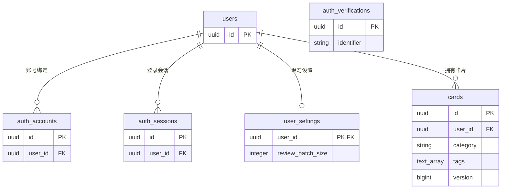
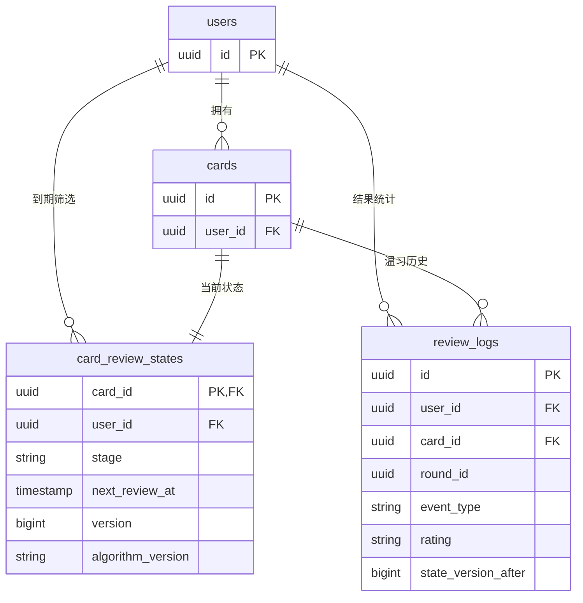
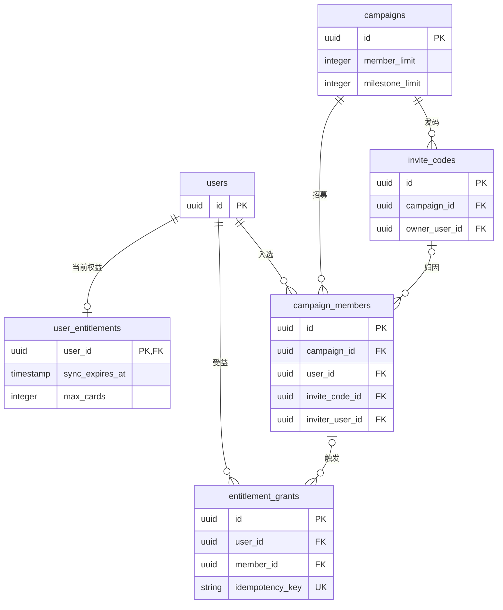
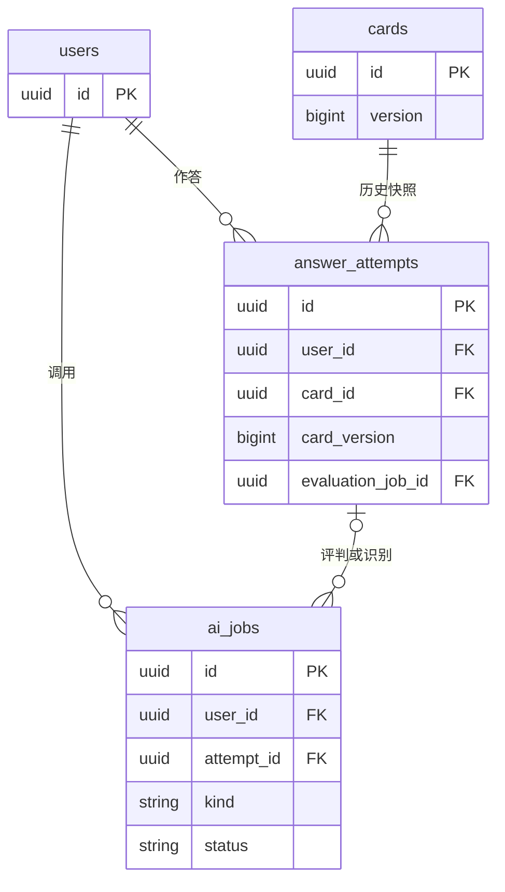
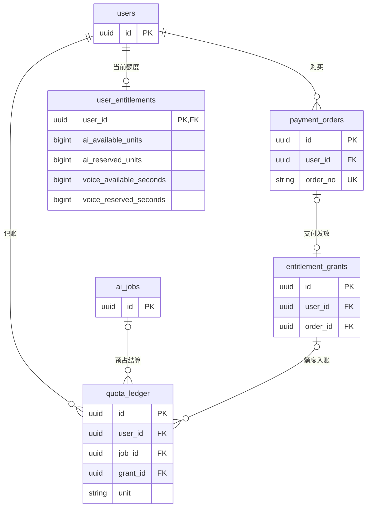

**状态：数据库设计草案 v1（按本轮决策修订）；尚未建库或接入代码。** PostgreSQL 为建议选型。登录与会话使用 Better Auth；轮内队列和重复练习计数保留在客户端。

MVP 为 **4 张业务表**（`user_settings`、`cards`、`card_review_states`、`review_logs`），加 Better Auth 管理的4张核心表，共8张。后续邀请内测增加5张，AI/语音和收费/计量各增加2张，共9张扩展表，按功能逐步启用。

设计依据：温习社竞品调研：能力与规划对照；当前 Jira 需求；生产工程 `README.md`、`AGENTS.md`、`db/README.md`。当前三档反馈仍为熟知 / 模糊 / 忘记。本次仅修改这份数据库方案，未改变 Jira 或实现代码。

# 1. 设计边界与统一约定

- 产品心智统一为“卡片”；首次介绍可叫“记忆卡片”。“添加卡片”“卡片管理”“今日温习卡片”对应数据实体 `cards`。当前卡片内容仍可使用问题、题干和参考答案，不限于面试场景。
- 卡片=题目
- 用户自建的个人题目，不另建“题库/牌组”表；后续真的支持多个题库、共享或协作时再加。
- 一题最多一个分类、可以有多个标签。分类和标签都属于用户，不做全站公共字典。
- 题目内容、当前温习状态、每次温习历史分开。改题不重写旧作答，删除题目不抹掉既有学习事实。
- 常规必填字段使用 NOT NULL；下表明确写 NULL 的字段允许为空。枚举先用 varchar + CHECK 白名单；不把经常调整的业务分档做成难迁移的数据库原生枚举。
- JSONB 只放版本化规则、历史内容快照和模型输出；用户归属、金额、状态、关键关系都保留为独立列。
- 每张可变表的 updated_at 由服务端更新；历史/流水是追加记录，不设 updated_at 让业务覆盖。ID 不承担权限作用。
- 卡片内容、当前长期温习状态、已完成学习结果分开。轮内队列、剩余熟知次数和重复出卡顺序仅在本端；本次不保存未完成卡片的反馈。
- 业务表使用 UUID 和 timestamptz；业务自然日先固定 Asia/Shanghai。Better Auth 的主键统一配置 UUID，实际迁移需与选定适配器生成的 schema 对齐。
- 枚举采用字符串列与 CHECK 白名单，应用层用 TypeScript 联合类型。阶段为 `new / review_1d / review_7d / review_30d`；扩展阶段仍需更新转换规则和迁移。

# 2. 表清单与实施阶段

| 阶段 | 物理表名 | 作用 |
| --- | --- | --- |
| MVP · Better Auth | `users` | 库的 user 模型映射；身份主键与资料 |
| MVP · Better Auth | `auth_sessions` | 库的 session 模型映射；会话生命周期 |
| MVP · Better Auth | `auth_accounts` | 库的 account 模型映射；外部身份/令牌 |
| MVP · Better Auth | `auth_verifications` | 库的 verification 模型映射；临时验证数据 |
| MVP · 业务 | `user_settings` | 每轮目标卡片数量 |
| MVP · 业务 | `cards` | 卡片内容、分类字符串、标签数组 |
| MVP · 业务 | `card_review_states` | 一张卡片的当前长期温习状态 |
| MVP · 业务 | `review_logs` | 已完成温习结果；预留未来反馈日志类型 |
| 邀请内测 | `campaigns` | 内测活动 |
| 邀请内测 | `invite_codes` | 邀请码 |
| 邀请内测 | `campaign_members` | 入选与邀请归因 |
| 邀请内测 | `user_entitlements` | 当前权益与额度 |
| 邀请内测 | `entitlement_grants` | 权益发放记录 |
| AI作答 | `answer_attempts` | 文字/语音作答 |
| AI作答 | `ai_jobs` | AI与语音任务 |
| 收费 | `payment_orders` | 订单 |
| AI/语音计量 | `quota_ledger` | 额度流水 |

Better Auth 表名通过模型映射配置，不在同一项目中再维护另一套自制登录表。鉴权字段、索引与迁移由固定版本、适配器和配置生成，见第4节。

邀请与奖励对应 SCRUM-37/41/42/43；AI和回顾/错题对应 SCRUM-10/44/45；导入对应 SCRUM-13/19/38；语音对应 SCRUM-39；收费对应 SCRUM-40。JSON/CSV 格式差异由解析层处理，最终写入同一张 cards 表。

# 3. ER 图

图中 PK 为主键、FK 为外键、UK 为唯一键；0..1 是可选单条，0..N 是可有多条。图只画主要关系和关键字段，完整复合外键见字段字典及第6节。重复出现的同名表是同一张表。实体属性中的 timestamp 在物理设计里均使用 timestamptz；text_array 对应 PostgreSQL text[]。

## 3.1 账户、设置与卡片

鉴权4张表的完整字段由 Better Auth 生成，图中仅列关键引用。auth_verifications 为独立验证实体，无用户外键；user_settings 为每轮出卡数量设置。cards.category 为字符串，cards.tags 为字符串数组，均不再引用分类/标签表。



## 3.2 温习状态与结果日志



开始一轮时，读取 user_settings.review_batch_size 后在本地固定实际卡片集合和数量；没有每日首轮快照表，也不持久化完整轮内队列。创建卡片时同事务创建状态行，保证应用内一张卡片一份当前状态。review_logs 是完成结果，MVP不记录每次轮内点击。algorithm_version 在MVP均为空。

## 3.3 邀请内测与权益



邀请码所有者、成员邀请人也引用 users；为减少交叉线，图内仅在字段中标注。邀请奖励的“触发成员”是受邀者，“权益受益人”是邀请人，两者可以不同。

## 3.4 AI、语音与历史作答



answer_attempts.evaluation_job_id 是已应用结果的反向引用；先建两张表再补外键。评判、语音识别、文本纠错可以是同一份作答的不同任务；只有用户确认的最终文字才能进入评判。

## 3.5 订单、权益入账与用量



权益发放可能来自活动，未必有订单；只卖同步的订单未必产生额度流水。user_entitlements 是快照，quota_ledger 是额度变更事实，二者由事务维护。

可编辑的 draw.io XML 源文件（5页；可导入 draw.io）：

wenxi-cards-database-er.drawio.xml

# 4. 核心字段与鉴权边界

## 4.1 Better Auth 管理的4张表

采用数据库会话模式。物理表名拟通过 Better Auth 的模型映射设置为下列名称；核心字段、索引、令牌存储和会话生命周期以**锁定版本及适配器生成的 schema** 为准。取消自制外部身份表，不自行实现另一套会话系统，也不强加原稿的 token_hash 设计。

| Better Auth 模型 | 拟映射表名 | 本项目的使用方式 |
| --- | --- | --- |
| user | `users` | 业务统一引用此表的id；昵称/头像复用库的name/image映射，不额外复制一个用户身份。 |
| session | `auth_sessions` | 登录、续期、退出、撤销由库管理；不再手工规定token摘要或自行编写认证中间件。 |
| account | `auth_accounts` | 微信等外部账号与令牌由库管理；provider和身份标识按官方模型保存。 |
| verification | `auth_verifications` | 临时验证数据由库管理；它不天然引用users，不在ER图中虚构user_id外键。 |
- Better Auth 配置统一使用 UUID 主键（`advanced.database.generateId: "uuid"`），业务表 user_id 同为 uuid。若所选适配器生成的实际类型不同，先统一迁移类型再建外键。
- 映射 name → nickname、image → avatar_url、userId → user_id、时间字段 → created_at/updated_at；email、email_verified 及其余核心字段遵循生成 schema。微信不提供邮箱的注册路径必须用所选库版本实测，不强迫用户填邮箱，也不把虚构邮箱标为已验证。
- 原用户资料中的 `status`（active/disabled）、`wechat_platform_id`、`wechat_unionid`、`last_login_at` 如继续保留，通过受控 additionalFields/hook 对接；归属、禁用状态和已验证身份等服务端字段不允许客户端任意填写。平台命名空间与UnionID成对出现，已验证的非空组合唯一。
- 每轮数量统一保存在 user_settings，users 不再保留重复设置。
- 网站微信扫码使用官方 WeChat provider。小程序登录属于后续独立接入核对，不能把网站扫码配置直接当小程序登录实现。
- 所有业务接口先用库读取有效会话，再校验卡片/日志/权益归属；用库不等于自动拥有业务行级权限。

Better Auth 数据库与Schema生成 · 会话管理 · 微信网站登录

## 4.2 自有业务表：4张

## user_settings · 用户温习设置

| 字段 | PostgreSQL 类型 | 空值 / 默认 / 键 | 含义 |
| --- | --- | --- | --- |
| `user_id` | uuid | PK；FK users(id) | 每个用户一条 |
| `review_batch_size` | integer | NOT NULL；默认10 | 每轮希望抽取的卡片数 |
| `created_at` | timestamptz | NOT NULL；默认now() | 首次保存时间 |
| `updated_at` | timestamptz | NOT NULL；默认now() | 设置修改时间 |

约束与索引：CHECK review_batch_size > 0。默认10由数据库默认值与服务端配置保持一致；上限由产品确认后配置。首次使用按用户ID幂等创建设置。当前轮次在开始时读取此值并固定本地目标数量；设置修改仅影响新轮次。实际选到数量=min(目标数量,符合筛选的可选数量)。不另设每日首轮快照表。

## cards · 卡片

| 字段 | PostgreSQL 类型 | 空值 / 默认 / 键 | 含义 |
| --- | --- | --- | --- |
| `id` | uuid | PK | 业务卡片ID |
| `user_id` | uuid | NOT NULL；FK users(id) | 卡片所有者 |
| `category` | text | NULL | 单个分类名称，无分类为NULL |
| `tags` | text[] | NOT NULL；默认空数组 | 标签名称数组，无标签为空数组 |
| `title` | text | NOT NULL | 卡片标题，非空 |
| `body` | text | NOT NULL；默认空串 | 补充题干/内容 |
| `reference_answer` | text | NOT NULL | 当前问答卡的参考答案，非空 |
| `content_hash` | char(64) | NOT NULL | 内容规范化后计算的SHA-256摘要 |
| `version` | bigint | NOT NULL；默认1 | 编辑版本，每次修改递增 |
| `created_at` | timestamptz | NOT NULL；默认now() | 创建时间 |
| `updated_at` | timestamptz | NOT NULL；默认now() | 最近修改时间 |
| `deleted_at` | timestamptz | NULL | 软删除标记 |

约束与索引：UNIQUE(user_id,id)；未删除卡片的部分唯一索引(user_id,content_hash)。CHECK version>0、title/reference_answer 非空；category 非空时不允许纯空白，tags 不允许NULL元素或空名称。标签先在服务端去重并统一首尾空白，代码内容的大小写和内部空格不改。列表索引(user_id,created_at DESC,id DESC) WHERE deleted_at IS NULL；分类索引(user_id,category) WHERE deleted_at IS NULL；标签筛选需要时增加 GIN(tags) WHERE deleted_at IS NULL。分类/标签仅作元数据，不参与内容去重摘要。

## card_review_states · 当前长期温习状态

| 字段 | PostgreSQL 类型 | 空值 / 默认 / 键 | 含义 |
| --- | --- | --- | --- |
| `card_id` | uuid | PK | 一张卡片一份当前状态 |
| `user_id` | uuid | NOT NULL | 为按用户查到期卡片保留的冗余归属 |
| `stage` | varchar(24) | NOT NULL；默认new | new / review_1d / review_7d / review_30d |
| `last_rating` | varchar(16) | NULL | 最近一次完成结果的rating，不代表轮内最后一次点击 |
| `last_reviewed_at` | timestamptz | NULL | 最近一条已完成温习结果的服务端时间 |
| `next_review_at` | timestamptz | NULL | 新卡片为空；已排期卡片为下次时间 |
| `version` | bigint | NOT NULL；默认0 | 每次成功保存完成结果递增，用于条件更新 |
| `algorithm_version` | varchar(32) | NULL；MVP不使用 | 未来产生当前排期的算法规则版本 |
| `updated_at` | timestamptz | NOT NULL；默认now() | 状态更新时间 |

约束与索引：复合FK(user_id,card_id) → cards(user_id,id)；CHECK stage IN ('new','review_1d','review_7d','review_30d')、version>=0；last_rating 允许 known/fuzzy/forgot 或NULL。到期查询索引(user_id,next_review_at,card_id)。version 防止旧状态覆盖新状态，不代替幂等ID；MVP algorithm_version 始终NULL，不强制填写伪版本。

## review_logs · 持久化温习结果

| 字段 | PostgreSQL 类型 | 空值 / 默认 / 键 | 含义 |
| --- | --- | --- | --- |
| `id` | uuid | PK | 一次逻辑提交的固定ID；客户端生成一次，重试沿用 |
| `user_id` | uuid | NOT NULL | 日志归属，由服务端从会话取得 |
| `card_id` | uuid | NOT NULL | 对应卡片 |
| `card_version` | bigint | NOT NULL | 温习时卡片版本；保存前校验 |
| `round_id` | uuid | NOT NULL | 本地轮次标识，用于分组与防重复完成 |
| `event_type` | varchar(24) | NOT NULL；默认card_completed | MVP只允许card_completed；feedback为未来预留 |
| `rating` | varchar(16) | NOT NULL | 完成记录为本轮最困难反馈的摘要；未来feedback记录单次反馈 |
| `reviewed_at` | timestamptz | NOT NULL；默认now() | 服务端接受本次提交的时间 |
| `stage_before` | varchar(24) | 条件必填 | card_completed为写入前阶段；未来feedback为空 |
| `stage_after` | varchar(24) | 条件必填 | card_completed为写入后阶段；未来feedback为空 |
| `next_review_at` | timestamptz | 条件必填 | card_completed为新排期；未来feedback为空 |
| `state_version_after` | bigint | 条件必填 | card_completed为成功写入后的状态版本；未来feedback为空 |
| `algorithm_version` | varchar(32) | NULL；MVP不使用 | 未来记录此次所用的规则版本 |

约束与索引：复合FK(user_id,card_id) → cards(user_id,id)。CHECK event_type IN ('card_completed','feedback')、rating IN ('known','fuzzy','forgot')。card_completed 要求阶段、下次排期、state_version_after非空；feedback要求这些结果字段为空。部分唯一索引(user_id,round_id,card_id) WHERE event_type='card_completed'；部分唯一索引(card_id,state_version_after) WHERE event_type='card_completed'。索引(user_id,reviewed_at)。id重试只返回本用户原记录，相同ID带不同业务输入拒绝。MVP接口仅接受card_completed，不因数据库允许feedback就开放功能。 阶段结果字段非空时使用与card_review_states.stage相同的字符串白名单；card_version>0，state_version_after非空时>0。

### user_id 是否会更快

本版在 card_review_states **保留 user_id**，目的是支持常用的“按用户筛选到期卡片”，建立 `(user_id,next_review_at,card_id)` 索引，先限定用户再扫描到期范围。归属复合外键保证它与 cards 的所有者一致。

保留这个字段不代表查询必然更快。没有它，也可以先通过 cards.user_id 筛出卡片再关联状态；用户卡片少时，两种方案都可能很快，实际取决于数据量、筛选条件和执行计划。当前尚无数据库及性能测试，不能声称已有速度收益。上线后用同一数据集的 EXPLAIN (ANALYZE, BUFFERS) 比较。PostgreSQL 多列索引文档

### version 与 algorithm_version

`version` 是并发控制：两端都读到版本3时，第一份完成结果写成4，另一份基于3的请求拒绝覆盖。幂等ID则保证同一提交重试不执行第二次。

`algorithm_version` 是未来的排期规则版本，例如将来上线新间隔规则时使用。字段保留为NULL扩展位，MVP无版本路由、无强制填写、无旧规则兼容分支；启用时先定义版本标识、旧数据迁移及结果追溯规则。

# 5. 后续扩展字段：按功能启用

以下是提前核对关系的方案，不要求首发同步建表。跨阶段字段在对应功能上线时迁移增加。

- 邀请制内测：5张表

  ## campaigns · 内测活动

  | 字段 | PostgreSQL 类型 | 空值 / 默认 / 键 | 含义 |
      | --- | --- | --- | --- |
  | `id` | uuid | PK | 活动ID |
  | `code` | varchar(40) | 唯一；必填 | 活动标识 |
  | `name` | varchar(100) | 必填 | 活动名称 |
  | `status` | varchar(16) | 必填 | draft / active / closed |
  | `starts_at` | timestamptz | 必填 | 开始时间 |
  | `ends_at` | timestamptz | NULL | 结束时间 |
  | `member_limit` | integer | 必填 | 当前规划约1000人，以确认值配置 |
  | `member_count` | integer | 默认0 | 已入选人数，事务内递增 |
  | `milestone_limit` | integer | 必填 | 当前达标奖规划100人 |
  | `milestone_claimed_count` | integer | 默认0 | 已成功领取的达标奖名额 |
  | `rule_version` | integer | 默认1 | 活动规则版本 |
  | `rules` | jsonb | 必填 | 试用额度、达标条件、权益时间口径等规则快照 |
  | `created_at` | timestamptz | 默认 now() | 创建时间 |
  | `updated_at` | timestamptz | 默认 now() | 更新时间 |

  约束与索引：人数和名额非负且不超过对应上限；发奖和入选时锁活动行。活动生效后不可原地改旧规则：新建活动/规则版本，既有成员保留自己的快照。

  ## invite_codes · 邀请码

  | 字段 | PostgreSQL 类型 | 空值 / 默认 / 键 | 含义 |
      | --- | --- | --- | --- |
  | `id` | uuid | PK | 邀请码记录ID |
  | `campaign_id` | uuid | FK campaigns；必填 | 所属活动 |
  | `owner_user_id` | uuid | FK users；NULL | 邀请人；官方种子邀请可为空 |
  | `code_hash` | char(64) | 唯一；必填 | 高熵邀请码摘要 |
  | `max_uses` | integer | 必填 | 最大使用人数 |
  | `used_count` | integer | 默认0 | 已使用次数 |
  | `expires_at` | timestamptz | NULL | 过期时间 |
  | `revoked_at` | timestamptz | NULL | 撤销时间 |
  | `created_at` | timestamptz | 默认 now() | 创建时间 |

  约束与索引：UNIQUE(campaign_id,id)；CHECK max_uses>0、used_count BETWEEN 0 AND max_uses。创建时返回原码，库内仅存摘要；码所有者及活动归属不可变。

  ## campaign_members · 入选与邀请归因

  | 字段 | PostgreSQL 类型 | 空值 / 默认 / 键 | 含义 |
      | --- | --- | --- | --- |
  | `id` | uuid | PK | 入选记录ID |
  | `campaign_id` | uuid | FK campaigns；必填 | 活动 |
  | `user_id` | uuid | FK users；必填 | 受邀/入选用户 |
  | `invite_code_id` | uuid | NULL | 使用的邀请码 |
  | `inviter_user_id` | uuid | FK users；NULL | 邀请人，取邀请码所有者快照 |
  | `rule_version` | integer | 必填 | 入选时规则版本 |
  | `rule_snapshot` | jsonb | 必填 | 入选时规则，避免后续改配置影响老用户 |
  | `joined_at` | timestamptz | 默认 now() | 试用/入选起点 |
  | `qualified_at` | timestamptz | NULL | 受邀者达到邀请奖励条件的时间 |
  | `qualification_evidence` | jsonb | NULL | 服务端核定的条件、日期、卡片数证据 |

  约束与索引：UNIQUE(campaign_id,user_id)；FK(campaign_id,invite_code_id) → invite_codes(campaign_id,id)。CHECK inviter_user_id IS NULL OR inviter_user_id<>user_id；邀请人由服务端从邀请码确定，不接受前端任意指定。 增加 UNIQUE(campaign_id,id)，供活动归属复合外键引用。

  ## user_entitlements · 当前权益与额度

  | 字段 | PostgreSQL 类型 | 空值 / 默认 / 键 | 含义 |
      | --- | --- | --- | --- |
  | `user_id` | uuid | PK；FK users | 权益归属 |
  | `sync_expires_at` | timestamptz | NULL | 无权益或有效截止时间 |
  | `max_cards` | integer | 必填 | 可同步卡片数量上限；试用规划100 |
  | `max_card_chars` | integer | 必填 | 单张卡片字数上限；试用规划1000 |
  | `ai_available_units` | bigint | 默认0 | 未占用AI额度；AI接入时新增列 |
  | `ai_reserved_units` | bigint | 默认0 | 处理中预占AI额度；AI接入时新增列 |
  | `voice_available_seconds` | bigint | 默认0 | 未占用语音秒数；语音接入时新增列 |
  | `voice_reserved_seconds` | bigint | 默认0 | 处理中预占语音秒数；语音接入时新增列 |
  | `version` | bigint | 默认0 | 权益变更版本 |
  | `updated_at` | timestamptz | 默认 now() | 更新时间 |

  约束与索引：所有数量非负，卡片数和字数上限为正数。此表是当前快照，授权发放以 entitlement_grants 留痕；额度变化以 quota_ledger 留痕。试用期不提前增加AI/语音四列。

  ## entitlement_grants · 权益发放记录

  | 字段 | PostgreSQL 类型 | 空值 / 默认 / 键 | 含义 |
      | --- | --- | --- | --- |
  | `id` | uuid | PK | 一份发放凭证，包含同次奖励的全部权益 |
  | `user_id` | uuid | FK users；必填 | 受益人 |
  | `campaign_id` | uuid | FK campaigns；NULL | 活动来源 |
  | `member_id` | uuid | FK campaign_members；NULL | 触发奖励的入选记录，受邀者和受益人可不同 |
  | `order_id` | uuid | FK payment_orders；NULL | 付费上线时新增列 |
  | `trigger_type` | varchar(24) | 必填 | trial / referral / milestone / payment |
  | `idempotency_key` | text | 唯一；必填 | 由服务端按来源生成，不使用每次随机值 |
  | `rule_snapshot` | jsonb | 必填 | 发放依据、规则版本及时间口径 |
  | `benefits_snapshot` | jsonb | 必填 | 解析后的同步截止时间、上限、AI额度、语音秒数 |
  | `sync_expires_before` | timestamptz | NULL | 变更前的同步截止时间 |
  | `sync_expires_after` | timestamptz | NULL | 变更后的同步截止时间 |
  | `applied_at` | timestamptz | 默认 now() | 已成功入账时间 |

  约束与索引：一笔发放和当前权益更新同事务提交；只记录成功发放，无半完成状态。trial/referral/milestone 必须有关联活动和成员且无订单；payment 必须有关联订单且无活动/成员，收费迁移时加条件CHECK。referral 的唯一键包含活动、受益人和受邀者，milestone 包含活动和受益人，payment 使用订单ID。member_id 必须属于 campaign_id；付费上线后 FK(user_id,order_id) → payment_orders(user_id,id)。 增加 UNIQUE(user_id,id)；FK(campaign_id,member_id) → campaign_members(campaign_id,id)，member_id 非空时 campaign_id 必须非空。 收费阶段增加 order_id 非空的部分唯一索引，保证一订单至多一份权益包。

- AI与语音：2张表

  ## answer_attempts · 文字/语音作答

  | 字段 | PostgreSQL 类型 | 空值 / 默认 / 键 | 含义 |
      | --- | --- | --- | --- |
  | `id` | uuid | PK | 一次作答ID |
  | `user_id` | uuid | 必填 | 作答者 |
  | `card_id` | uuid | 必填 | 原卡片 |
  | `card_version` | bigint | 必填 | 作答时卡片版本 |
  | `round_id` | uuid | NULL | 来自温习轮次时填写 |
  | `input_mode` | varchar(16) | 必填 | text / voice |
  | `card_snapshot` | jsonb | 必填 | 卡片标题、题干、参考答案快照 |
  | `raw_transcript` | text | NULL | 语音原始识别文本 |
  | `corrected_transcript` | text | NULL | 基于卡片纠错后的建议文本 |
  | `answer_text` | text | NULL | 用户确认后的最终作答；draft阶段可空 |
  | `status` | varchar(16) | 默认 draft | draft / submitted |
  | `submitted_at` | timestamptz | NULL | 用户确认提交时间，voice也必须先确认 |
  | `evaluation_status` | varchar(16) | 默认 none | none / pending / succeeded / failed |
  | `has_error` | boolean | NULL | AI成功判断后有值；失败不能记false |
  | `has_omission` | boolean | NULL | 是否有必要遗漏 |
  | `quality_rating` | varchar(32) | NULL | 开放题质量评级；分档待定 |
  | `evaluation_feedback` | jsonb | NULL | 具体错误、遗漏、评级依据 |
  | `evaluation_job_id` | uuid | NULL | 应用到本次作答的成功AI任务 |
  | `created_at` | timestamptz | 默认 now() | 创建时间 |

  约束与索引：UNIQUE(user_id,id)、UNIQUE(user_id,card_id,id)。复合FK(user_id,card_id) → cards(user_id,id)；evaluation_job_id 建表后补复合外键，校验 job.user_id 与 attempt_id 匹配。submitted 必须有非空 answer_text、submitted_at；succeeded 必须有两个判断布尔值。卡片编辑不改历史快照。

  ## ai_jobs · AI与语音任务

  | 字段 | PostgreSQL 类型 | 空值 / 默认 / 键 | 含义 |
      | --- | --- | --- | --- |
  | `id` | uuid | PK | 逻辑任务ID，重试不换ID |
  | `user_id` | uuid | FK users；必填 | 调用者 |
  | `attempt_id` | uuid | NULL | 评判/识别/纠错关联作答；导入可空 |
  | `kind` | varchar(24) | 必填 | evaluate / import / transcribe / correct |
  | `idempotency_key` | text | 必填 | 用户内幂等键 |
  | `request_hash` | char(64) | 必填 | 防同键不同内容 |
  | `status` | varchar(16) | 默认 pending | pending / running / succeeded / failed / unknown |
  | `provider` | varchar(40) | 必填 | 调用服务 |
  | `model` | varchar(100) | NULL | 模型或识别引擎版本 |
  | `prompt_version` | varchar(40) | NULL | 提示词/热词处理规则版本 |
  | `request_snapshot` | jsonb | 必填 | 确定的输入、卡片版本和热词；按留存策略清理正文 |
  | `result` | jsonb | NULL | 模型结构化结果或导入候选卡 |
  | `provider_request_id` | text | NULL | 服务商请求标识，用于查账/排障 |
  | `quota_unit` | varchar(24) | NULL | ai_unit / voice_second；计费口径待定 |
  | `reserved_units` | bigint | 默认0 | 调用前预占 |
  | `settled_units` | bigint | 默认0 | 实际结算额度 |
  | `retry_count` | integer | 默认0 | 内部重试次数 |
  | `error_code` | varchar(80) | NULL | 失败或未知原因 |
  | `created_at` | timestamptz | 默认 now() | 创建时间 |
  | `finished_at` | timestamptz | NULL | 确定结束时间 |

  约束与索引：UNIQUE(user_id,id)、UNIQUE(user_id,idempotency_key)；FK(user_id,attempt_id) → answer_attempts(user_id,id)。evaluate/transcribe/correct 必须关联 attempt_id；import 不关联作答。同用户/同作答的 evaluate 类型任务是否允许付费重评，单独定规则；一次逻辑提交的系统重试只结算一次。 增加 UNIQUE(user_id,attempt_id,id)，供 answer_attempts(user_id,id,evaluation_job_id) → ai_jobs(user_id,attempt_id,id) 引用；评判任务 kind、成功状态由同一服务端事务校验。

- 收费与用量：2张表

  ## payment_orders · 订单

  | 字段 | PostgreSQL 类型 | 空值 / 默认 / 键 | 含义 |
      | --- | --- | --- | --- |
  | `id` | uuid | PK | 订单ID |
  | `user_id` | uuid | FK users；必填 | 购买人 |
  | `order_no` | varchar(64) | 唯一；必填 | 商户订单号 |
  | `product_key` | varchar(64) | 必填 | 套餐代码，初期产品目录放服务端配置 |
  | `product_snapshot` | jsonb | 必填 | 下单时名称、价格、权益、有效期规则快照 |
  | `amount_minor` | bigint | 必填 | 最小货币单位金额，例如人民币分 |
  | `currency` | char(3) | 默认 CNY | 币种 |
  | `status` | varchar(24) | 默认 pending | pending / paid / closed / refund_pending / refunded |
  | `payment_provider` | varchar(24) | 必填 | 支付渠道 |
  | `provider_transaction_id` | text | NULL | 支付平台交易号 |
  | `paid_at` | timestamptz | NULL | 服务端核验后的支付成功时间 |
  | `created_at` | timestamptz | 默认 now() | 创建时间 |
  | `updated_at` | timestamptz | 默认 now() | 更新时间 |

  约束与索引：UNIQUE(user_id,id)；UNIQUE(payment_provider,provider_transaction_id)（NULL可重复）。CHECK amount_minor>=0。核验签名、商户、订单、金额、币种后变更状态；付款页跳转不作支付凭证。当前只设计单套餐订单；部分退款与自动续费未确定，不预建相关表。

  ## quota_ledger · 额度流水

  | 字段 | PostgreSQL 类型 | 空值 / 默认 / 键 | 含义 |
      | --- | --- | --- | --- |
  | `id` | uuid | PK | 流水ID |
  | `user_id` | uuid | FK users；必填 | 额度账户 |
  | `job_id` | uuid | NULL | 关联AI/语音逻辑任务 |
  | `grant_id` | uuid | NULL | 来自权益发放的入账 |
  | `unit` | varchar(24) | 必填 | ai_unit / voice_second，不混合计量 |
  | `entry_type` | varchar(16) | 必填 | grant / reserve / consume / release / adjust |
  | `available_delta` | bigint | 必填 | 可用余额增减 |
  | `reserved_delta` | bigint | 必填 | 预占余额增减 |
  | `idempotency_key` | text | 必填 | 同一次入账/预占/结算步骤固定一个键 |
  | `created_at` | timestamptz | 默认 now() | 记账时间 |

  约束与索引：UNIQUE(user_id,idempotency_key)；FK(user_id,job_id) → ai_jobs(user_id,id)，FK(user_id,grant_id) → entitlement_grants(user_id,id)，后者需补 UNIQUE(user_id,id)。CHECK 两项delta至少一个非零；grant 为可用增加，reserve 为可用减少/预占等额增加，consume 为预占减少，release 为预占减少/可用等额增加；按类型增加CHECK。锁 user_entitlements 行后校验余额不负，再同事务写流水和快照。


# 6. 数据归属、筛选与索引

## 6.1 分类和标签直接保存在卡片

`category` 为一个可空字符串，`tags` 为字符串数组。名称从当前用户未删除卡片中去重获取；不拼接成逗号分隔字符串，不再有分类/标签外键。

服务端统一首尾空白、标签去重及名称比较规则。整类/整标签改名时，批量更新当前用户的匹配卡片；不能影响其他用户，也不保留没有任何卡片使用的独立分类/标签实体。

## 6.2 用户归属约束

服务端用户ID只取 Better Auth 的有效会话。状态、日志、未来作答等表用复合外键与 cards 的归属保持一致：

```sql
ALTER TABLE cards
  ADD CONSTRAINT cards_owner_key UNIQUE (user_id, id);

ALTER TABLE card_review_states
  ADD CONSTRAINT card_review_states_owner_fk
    FOREIGN KEY (user_id, card_id) REFERENCES cards(user_id, id);

ALTER TABLE review_logs
  ADD CONSTRAINT review_logs_owner_fk
    FOREIGN KEY (user_id, card_id) REFERENCES cards(user_id, id);
```

这是关键约束示例，不是完整迁移。外键引用列组合需有唯一约束，引用侧按查询建立索引。PostgreSQL 官方约束文档

## 6.3 首发查询索引

| 场景 | 索引 / 查询方式 |
| --- | --- |
| 按用户取到期卡片 | card_review_states(user_id,next_review_at,card_id)，再关联cards排除deleted_at、套用分类/标签筛选；不是因有user_id就保证所有查询更快。 |
| 新卡片 | cards(user_id,created_at DESC,id DESC)，关联状态筛选last_reviewed_at IS NULL；MVP中未完成就退出的卡片仍保持原状态。 |
| 分类筛选 | cards(user_id,category) 的未删除记录部分索引；无分类使用IS NULL。 |
| 标签筛选 | 数组包含使用 tags @> ARRAY['React']::text[]；需要时建立 GIN(tags) WHERE deleted_at IS NULL，并始终带user_id条件。多个标签按全部包含还是任一命中由产品定义。 |
| 分类/标签列表 | 只读本人未删除卡片；category做DISTINCT，tags经unnest后DISTINCT。 |
| 精确导入去重 | cards(user_id,content_hash) 的未删除记录部分唯一索引。 |
| 当天/近7日/日历 | review_logs(user_id,reviewed_at)；按北京时间折算起止时间，并筛event_type='card_completed'。未来反馈日志不混入完成数量。 |
| 当前轮进度 | 分母为本地本轮实际选中卡片数，分子为本地已完成卡片数；修改设置或继续新轮不会重写当前轮。 |
| 分页 | 服务端分页、固定排序加ID兜底；内容包含查询在本用户数据范围内执行，规模上来再评估全文/pg_trgm索引。 |

## 6.4 卡片去重与编辑版本

保留原稿建议：仅对“标题 + 题干 + 参考答案完全一致”做精确内容去重。统一换行与外层空白，保留代码内部空格和大小写。分类、标签不参与摘要。

同用户才去重，重复导入跳过、不覆盖；同内容不同参考答案允许保留。这个重复口径仍需确认。编辑时使用 cards.version 条件更新，版本不符提示冲突，不自动覆盖。

# 7. 本地轮内温习与持久化结果

## 7.1 开始一轮与数量设置

读取 user_settings.review_batch_size（默认10），结合本轮分类/标签筛选选出卡片。返回实际卡片集合及round_id，本地固定这一轮的实际数量与队列。可选卡片不足时按实际数量出卡；零卡片不开始轮次。

设置保存的是“以后每轮出多少张”，不是每日计划或历史轮次快照。修改设置只作用于新轮次，不改变正在进行这一轮的分母。当前轮的跨端续答、每日首轮分母同步不在本次范围。

## 7.2 轮内动作留在本地

熟知、模糊、忘记带来的重复出卡、剩余熟知次数和排序由客户端维护。首次熟知本轮移出；首次模糊需再熟知2次；忘记后重置为再熟知3次。反复模糊、30天阶段后忘记的降级仍待确认。

不把每次点击提交给服务端复算，不保存轮内计数，不签发用于验证整套轮内动作的队列凭据。**每张卡完成本轮即可提交一次，不等待整轮全部卡片结束。**

review_logs.rating 建议记录“这张卡在本轮出现过的最困难反馈”，优先级 forgot > fuzzy > known，避免完成时最后一次必然是熟知导致历史丢失难度信息。它是完成结果的摘要，不是熟知点击计数；间隔转换仍依已确认规则计算，不因这个摘要命名自动新增算法规则。

## 7.3 一张卡完成后的保存事务

1. 先由 Better Auth 取得登录用户，按 user_id + 日志id查重。同一逻辑提交固定同一个id；命中且业务输入相同直接返回原结果，不重复推进。
2. 按一致顺序锁cards行再锁card_review_states行，核验归属、未删除、card_version和客户端提交的期望状态version。冲突返回最新状态，让客户端确认，不静默覆盖。
3. 服务端按当前阶段与已确认转换规则计算新的stage、next_review_at，version递增1；不接收客户端直接指定最终排期。
4. 插入一条 event_type='card_completed' 的review_logs，同时更新card_review_states，同事务提交。round_id+card_id的完成记录唯一约束可拦住同轮同卡换ID重复提交。
5. 当前状态的last_rating、last_reviewed_at与本次完成结果一致；MVP不填写algorithm_version。客户端可以先更新界面，但必须显示保存失败并用原ID重试。

version解决并发覆盖，日志ID及同轮唯一约束解决重复提交；二者不能互相替代。自评摘要是客户端上报的学习结果，不声称服务端已经核验每次轮内点击。

## 7.4 中途退出：本次行为与未来扩展

**MVP：** 未完成卡片的点击不写review_logs，也不改变长期状态。已完成卡片的结果照常保存；尚未完成的旧卡仍按原排期选取，新卡仍作为新卡。此时没有恢复其轮内计数的承诺，也不用在退出时补写一个虚构完成结果。

**未来预留：** review_logs.event_type 可区分 feedback 和 card_completed。若以后开启未完成反馈历史，每次实际反馈使用独立日志ID，记录用户、card_id、card_version、round_id、rating和reviewed_at；阶段、排期与state_version_after为空。feedback的rating是单次实际反馈，与card_completed的本轮摘要按类型区分。

同一轮同一卡可有多条feedback，只能有一条card_completed；唯一索引仅约束后者。中途退出后已有feedback可留历史，但不等于能恢复完整队列。统计和奖励查询只统计card_completed，避免把未完成反馈当完成；将来若需要“尝试过但未完成”的统计，单独查询feedback。

本次不开发feedback提交接口、退出自动保存、页面关闭监听或补传流程；数据库只保留兼容类型及可空结果字段。真正启用时再明确客户端时间、离线补传、保存时机和统计口径。

## 7.5 统计口径

完成数量按card_completed记录统计；当天温习过的不同卡片数按card_id去重。连续温习建议按“当天至少完成一张卡片”判断，活动的连续3天和10张熟知需另按rule_snapshot确认，不直接拿这个建议口径发奖。

掌握分公式未确定，先从字符串stage、last_rating及历史派生；review_30d仅表示30天阶段，不表示永不遗忘。删除卡片不抹掉既有完成历史。按服务端受理时间归日，迟到重试不伪造旧日期，轮次跨日的具体交互仍需确认。

# 8. 邀请、奖励与同步额度

## 8.1 邀请准入

注册账户和取得内测资格是两件事。用户首次微信登录可建账户；是否允许开始云端业务，再检查 campaign_members 与权益。邀请码有效性、活动总名额、码使用次数、入选记录和试用发放须同事务处理；锁活动行及邀请码行，杜绝并发超发。

试用卡片数100、单张卡片1000字、1个月是现有规划，以活动规则快照配置；不作为永久数据库常量。1000字是否包含标题/题干/答案、Unicode计数方式仍待确认。

## 8.2 发奖幂等与前100名

受邀者何时“达标”按 rule_snapshot 由服务端核验。邀请人的奖励唯一键可用“活动 + 邀请人 + 受邀者 + referral”；达标奖用“活动 + 用户 + milestone”。不按分享点击次数直接发奖。

领取达标奖时锁活动，先查是否已发，再检查剩余名额；写一份 entitlement_grants、更新用户权益和已领取人数，同事务提交。同步与语音若属于同一次奖励，放同一份 benefits_snapshot，不重复占两个获奖名额。

“10张卡片熟知”需明确是10张不同卡片、完成一次本轮，还是到某个长期阶段；连续3天的口径也待定。qualification_evidence 保存核验时的规则和事实，不能只留一个 qualified=true。

## 8.3 同步时间与卡片数量上限

邀请奖励“加1个月”和达标奖“延到3个月”不是同一操作。先由规则解析出具体截止时间，再落 benefits_snapshot 和前后截止时间。三个月从入选还是领奖起算、能否叠加、一个月按自然月还是固定天数，待确认。

创建卡片或导入时锁用户权益行，统计本人未删除卡片后校验上限；两笔同时导入不能各自绕过限额。具体导入失败策略待确认：建议首版整批校验通过后事务写入，返回重复项，不静默截断。

同步到期不删除用户数据；到期后可读、导出、编辑、复习各自开放到什么程度，需补充产品边界，不能只凭一个 expires_at 就自行决定。

# 9. AI、语音与计费扩展

## 9.1 卡片修改不篡改历史

用户提交作答时固定卡片版本、题干与参考答案快照。语音保留原始识别、纠错建议和用户确认后的最终文字三份文本；只评判 answer_text。音频文件本体后续按需要放对象存储，首版不默认永久保存。

一次系统逻辑任务使用固定 `ai_jobs.id` 和幂等键。模型返回后再次核验用户、作答与任务关系，只把合法成功结果写入 answer_attempts。失败不把 has_error/has_omission 写成 false。

错题列表建议取每张卡片“当前卡片版本下最近一次成功评判”的作答，按 submitted_at、id稳定排序；has_error 或 has_omission 为 true 则进入错题模式。改卡后旧评语仍可回顾，但不继续作为新版本错题判断。AI结果暂不自动改变自评与间隔，等待产品规则确认。

## 9.2 额度预占、结算与退款边界

发放额度记 grant；调用前从 available 转 reserved；成功后 consume，未用完的预占 release；确定失败再释放。快照和每一条 quota_ledger 同事务变更，每步有固定幂等键，可从流水重算对账。

若服务商超时但可能已执行，任务记 unknown，先查服务商结果再结算或释放，避免无限免费重试。供应商成本与向用户扣除的额度是两种口径，不能把 token成本直接当套餐价格；AI额度单位、语音时长的取整、失败是否收费、试用额度先后顺序均待确定。

退款规则、已用额度如何处理尚未确定；此处只预留订单状态与可追溯流水，不自动承诺不退款、部分退款或自动续费。

## 9.3 支付成功与权益入账

初期单套餐下单，产品目录可放服务端配置；订单保留 product_snapshot，不建商品、购物车和订单明细。支付回调核验后锁订单，paid状态与权益发放在同事务内完成；重复回调只返回同一结果。客户端不能提交 paid状态或自定价格。

# 10. 删除、同步与后续迁移

- 普通删除卡片填deleted_at，所有卡片库/选卡查询排除它；当前状态与历史保留。账号注销或真实清除按确认后的留存策略显式执行。
- 分类和标签是卡片字段。删除分类值即将匹配卡片的category置空；删除标签值即从匹配卡片的tags数组移除该值，始终限定当前用户，按卡片编辑规则更新version/updated_at。
- 云同步首版采用服务端为准的重新拉取和版本校验；不因有updated_at就宣称已有完整增量同步。离线/增量同步要另外设计稳定变更序列、删除墓碑保留与游标协议。
- 导入/导出不单独建历史表；AI导入异步调用复用ai_jobs。未来需要断点导入、逐条纠错报告时再加导入批次/明细表。
- Better Auth 固定版本、适配器及配置后生成鉴权schema，纳入项目版本化迁移；业务迁移先建user_settings/cards/card_review_states/review_logs。MVP不启用algorithm_version与feedback日志。
- 后续按邀请、AI、收费阶段加表/加列。未完成反馈历史只需在已预留的类型与约束上启用业务流程；如果未来要持久化完整轮次和队列，另行设计，不把反馈日志冒充队列。
- 不在应用启动时隐式修改生产结构；新增约束前先检查存量数据。

# 11. 实施前需要你拍板的规则

| 事项 | 当前已知 | 还需确定 | 答案 |
| --- | --- | --- | --- |
| 算法 | 熟知/模糊/忘记；1/7/30天阶段 | 反复模糊、30天阶段后忘记降级、间隔的精确时间口径。 | 改成FSRS算法，口径也是。 |
| 每轮数量 | user_settings.review_batch_size，MVP默认10 | 可配置上限；默认值后续调整是否影响已保存设置。 | **只保存用户主动修改的数量**：用户没设置，就每次使用全局默认值；默认改成 20，之后每轮就出 20 张。 |
| 统计 | 本地当前轮进度、掌握分、连续温习 | 掌握分公式；有效温习日定义；跨日的旧轮次交互；改卡是否重置温习进度。 |   1.
2. 温习日，就是自然日
3. 跨日的旧轮次，作废当没练
4. 改卡不重置温习进度。 |
   | 完成摘要 | rating建议记录本轮最困难反馈，轮内计数不入库 | 排期转换与完成摘要口径需与算法共同确认。 | 本轮选择最低的最为评分。
   只要有1次忘记Again，
   直接熟悉Easy，
   只点过一次模糊Good，
   其余都是Hard。
   |
   | 去重 | 重复不覆盖 | 是否采用本方案的精确内容去重，是否允许同一卡片内容但不同参考答案。 | 只对标题去重 |
   | 内测 | 100张卡片、单张卡片1000字、1个月 | 字数覆盖范围/计数方式；邀请码的使用上限。 | 最多 1000 个字符。
   如 标题、补充内容、参考答案合计；分类、标签不计。空格、换行各算 1，换行格式统一。一个完整 emoji 算 1 |
   | 邀请奖 | 受邀者达标后加1个月 | 达标条件；同一受邀者是否只能归因一次（本方案按每活动一次）。 | 同一受邀者绝对只能归因一次，避免任何薅羊毛等资损漏洞。 |
   | 达标奖 | 10张卡片熟知+连续3天，前100名，延至3个月 | 熟知的判定；三个月起算点；叠加规则；语音30分钟适用名额。 | 熟知的判定，本轮完成且上传后作数。
   奖励可叠加。 |
   | AI/语音 | 文字默认；语音确认后评判；有加量包 | 评级分档、计量单位、扣费/失败/过期规则；是否影响间隔。 | mvp暂不考虑 |
   | 到期与支付 | 内测后收费，纯同步暂定5元/月 | 到期后的服务边界；支付方式；退款与额度政策。 | mvp暂不考虑 |

# 12. 验证清单

- Better Auth 的用户、会话、账号、验证数据与生成schema一致；业务表user_id类型一致；业务归属由有效会话校验。
- 分类/标签名称来自本用户未删除卡片，按分类和数组标签筛选有效，不再依赖独立分类/标签表。
- 用户无设置时默认每轮10张；实际只有7张可选时出7张；修改设置不改变已开始轮次。
- 串改user_id或使用他人card_id：接口和复合外键均应拒绝。
- 同一卡完成请求重发10次：只有一条card_completed和一次状态推进；同轮同卡换ID提交仍不能重复完成。
- 两端同时保存同一卡：只有匹配version者成功；卡片已修改/删除时拒绝旧内容版本的完成结果。
- MVP未完成就退出：无未完成反馈历史，不更新长期状态；已完成卡片保存不受影响。feedback类型在接口层明确拒绝。
- stage使用字符串白名单；algorithm_version允许NULL且MVP不依赖它。
- 后续启用feedback时：同轮多次反馈与单次完成可共存；feedback结果字段为空；完成数量和奖励不把feedback算进去。
- 到期查询的user_id冗余始终与cards所有者一致；执行计划比较两种查法后再确认性能收益。
- 两人争最后一个奖励名额、重复受邀达标、并发导入冲击额度、支付回调或AI任务重试：不超发、不重复入账、不超限。
- 修改参考答案后回顾历史：保留当时快照，旧评语不直接标记当前版本错题。

以上为设计校验场景，未执行数据库集成测试；落地迁移时再验证。
